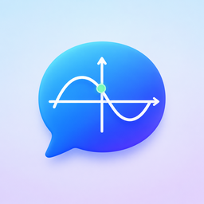
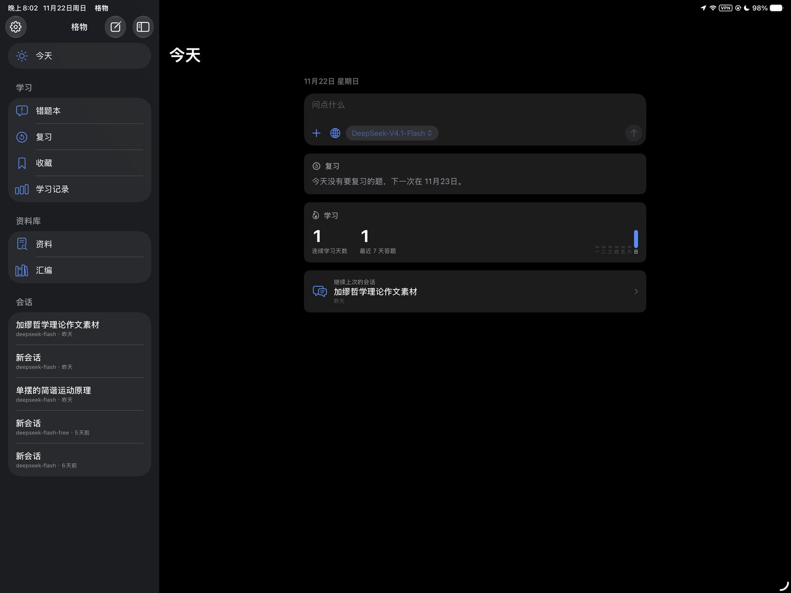
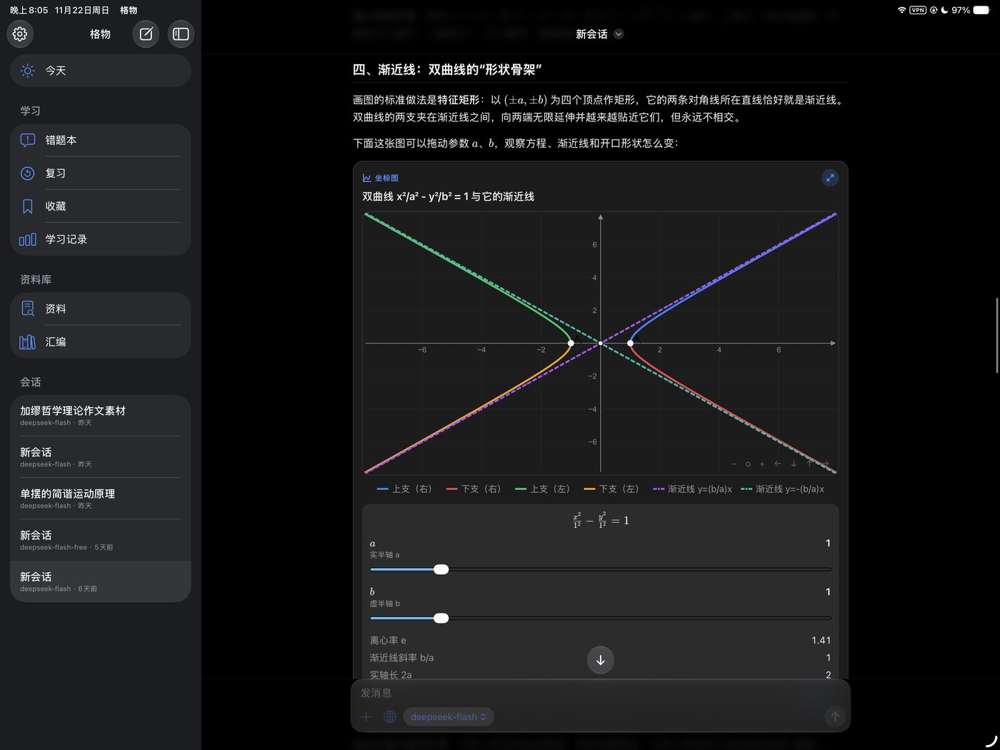
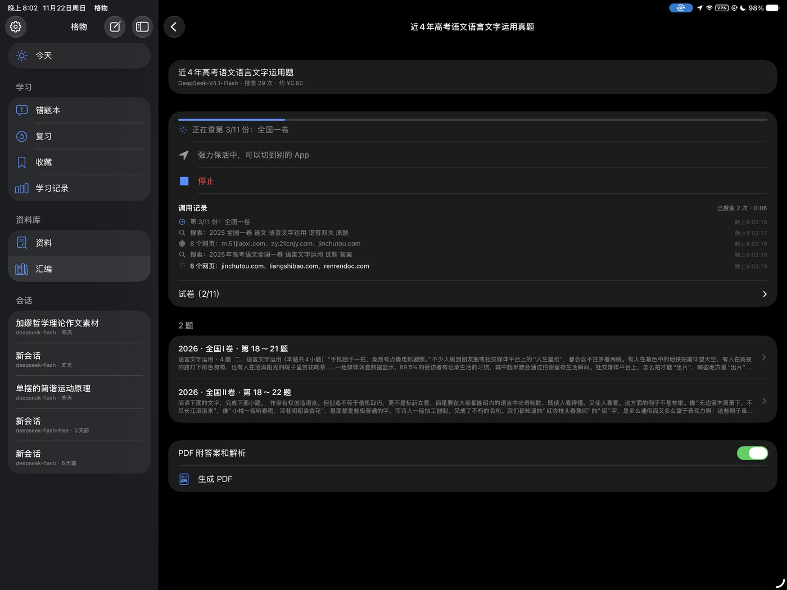

<p align="center">
  
</p>

<h1 align="center">格物（Gewu）</h1>

<p align="center">为学习做的大模型 App，运行在 iPhone 和 iPad 上。名字取自"格物致知"。</p>

<p align="center">
  <a href="https://github.com/LouisLu010/study-agent/releases"></a>
  
  <a href="./LICENSE"></a>
</p>

回答里可以有公式、化学式，也可以有能动手操作的坐标图、几何图、物理和化学模拟、测验；讲解方式可以换成循序渐进、启发式提问、考前速记或严格批改；答错的题进错题本，按 1、3、7、14、30 天复习；一句话就能联网汇编高考原题，排成 PDF。

用你自己的 API Key，没有服务器，数据只存在本机。没有上架 App Store，需要自签安装，见[构建与安装](#构建与安装)。

- 下载：[Releases](https://github.com/LouisLu010/study-agent/releases)，当前是 [0.9.0 Beta 2](https://github.com/LouisLu010/study-agent/releases/tag/v0.9.0-beta.2)
- 术语：[GLOSSARY.md](./GLOSSARY.md)
- 架构决策：[docs/adr/](./docs/adr/)
- 宣传片：[docs/promo/](./docs/promo/README.md)

## 截图

iPad 深色模式，第八版真机截图。

| 今天 | 会动的坐标图 | 汇编原题 |
|---|---|---|
|  |  |  |

## 能做什么

**会画图和出题的回答**
- Markdown、表格、代码高亮、LaTeX 公式、mhchem 化学式。
- 模型自己决定要不要在回答里放组件，组件只能从 App 内置的几种里选（[ADR-0006](./docs/adr/0006-fixed-component-library.md)）：
  - **坐标图**：拖参数，曲线实时变化，自动标出极值点、零点和交点。
  - **几何图**：拖动点，长度、角度、面积跟着变。
  - **图表**：柱状图、折线图、饼图。
  - **模拟**：单摆、弹簧振子、匀变速运动、碰撞、带电粒子在电场和磁场里的运动、电磁感应、电路、化学平衡等内置的模拟，可以调参数、拖时间轴。
  - **测验**：选择题和数值题，答完立刻看到对错和解析。
  - **分步讲解**：一步一步展开，每一步都可以追问。
- 模拟、坐标图和几何图可以全屏，横屏时参数在侧边。
- 简洁模式下只用文字、公式和化学式回答。

**讲解方式**
- 5 种人格：标准、循序渐进、启发式、考前速记、严格批改。设置里选一个默认的，每个会话可以单独换。
- 用户提示词对所有会话生效，例如"我是高二学生"；会话提示词只对一个会话生效。
- 回答下面有"讲简单点""换个思路""出道练习题"，点一下就发出。

**提问**
- 文字、拍照、相册、PDF（选页，每页作为一张图）、Apple Pencil 手写。
- 联网搜索用服务商自带的搜索，回答上方显示出处卡片。
- 某个组件格式有误时只重新生成这一个组件；重新生成整条回答会保留旧版本，可以来回切换；可以编辑提问后重发；回答被系统打断后可以接着写。
- 长按 App 图标：新会话、拍题、开始复习。

**错题和复习**
- 测验答错的题自动进错题本，也可以长按自己的提问加入。
- 按 1、3、7、14、30 天的间隔复习，到期时每天提醒一次（可以关）。
- "今天"汇总要复习的题、连续学习天数和最近 7 天答题数。
- 收藏整条回答；错题和收藏都是独立副本，删掉会话也还在。

**资料和汇编**
- **资料**：让模型联网查一个主题，整理成带出处的总结，可以编辑。
- **汇编**：一句话说要什么题，例如"近 3 年高考有机大题"。模型先列出试卷给你确认，再调用 App 的工具逐份找原题；原题的文字和图片取自出处网页，不由模型改写。最后排成 PDF，可以附答案和解析。生成期间可以切到别的 App。

**模型接入**
- 内置 DeepSeek、OpenAI、Anthropic、Google Gemini、OpenRouter 的预设，也可以填任意 OpenAI 兼容接口。
- 原生支持 OpenAI 兼容、Anthropic Messages、Gemini 三种协议，支持思考过程和思考强度。
- 每条回答显示 token 用量和估算费用（人民币）。

## 隐私和费用

- API Key 只存在设备的钥匙串里。App 直接请求服务商的接口，中间没有任何服务器（[ADR-0001](./docs/adr/0001-byok-no-backend.md)）。
- 会话、错题、资料和汇编只存在本机，不同步到 iCloud（[ADR-0004](./docs/adr/0004-local-only-until-paid-account.md)）。
- 费用由你的服务商按用量收取。App 里显示的金额是按官网标价折算的估算值。
- 打开"强力保活"后，生成汇编或长回答时会用后台定位让 App 保持运行，位置不记录、不发送。

## 构建与安装

App 以未签名的 `.ipa` 发布，要用 Sideloadly 或 AltStore 配合免费 Apple ID 签名安装，每 7 天需要重签一次。需要 iOS / iPadOS 18 及以上。

1. 打开 [Releases](https://github.com/LouisLu010/study-agent/releases)，在最新的版本下面下载 `StudyAgent-<版本>-unsigned.ipa`。下载不需要登录，也不会过期。
2. 用 Sideloadly 把它装到 iPhone 或 iPad 上，登录你的 Apple ID。
3. 在设备的"设置 → 通用 → VPN 与设备管理"里信任你的 Apple ID，然后打开 App。

新版本直接覆盖安装，已有的会话、错题和汇编都还在。

**从源码构建**：本仓库不包含 `.xcodeproj`。GitHub Actions 用 XcodeGen 从 `project.yml` 生成工程，运行测试、编译 App，并打包未签名的 `.ipa`。每次 CI 成功后，可以在那次运行的页面底部下载 `StudyAgent-unsigned-ipa`（要登录 GitHub，过一段时间会过期）。发布 GitHub Release（包括 pre-release）时，`.github/workflows/release.yml` 会按 Release 的标签编译同样的 IPA，命名为 `StudyAgent-<标签>-unsigned.ipa` 传到 Release 上。已经发布过的 Release 可以在 Actions 页面手动运行 "Release IPA"，填上标签来补传。

## 第一次使用

第一次打开 App 会出现引导：选一个服务商预设（DeepSeek、OpenAI、Anthropic、Google Gemini、OpenRouter，或者"其他"自己填地址），粘贴 API Key，App 拉一次模型列表来确认 Key 能用，然后选一个默认模型，再选年级和讲解人格（可以不选），可选打开复习提醒，最后直接进入一个新会话。引导可以跳过，设置 → 其他 → "重新查看引导"可以再走一遍。

不走引导的话，也可以手动添加：

1. 点左上角的齿轮打开设置，点"添加服务商"，选一个预设或"其他"，填写 API Key（"其他"还要填 API 地址）。
2. 在服务商页面点"从服务商获取模型"，在列表里勾选要用的模型后添加。如果服务商不提供模型列表接口，就点"手动添加模型"，填写模型 ID（必须和服务商文档里写的一样）。模型能看图的话，打开"支持图片输入"。第一个添加的模型会自动成为默认模型。
3. 回到会话列表，点右上角新建会话，就可以开始提问了。

API Key 只存在设备的钥匙串里，App 直接请求服务商的接口，中间没有任何服务器。

## 开发

### 目录

- `App/`：SwiftUI 界面、WebView 渲染、图片处理
- `App/Vendor/`：复制进来的第三方 Swift 源码（第六版起有 Thinking Orbs），各自附许可证
- `StudyKit/`：不依赖界面的代码（数据模型、三种协议、SSE 解析、内置提示词）和测试
- `Renderer/`：WebView 里运行的渲染器（Markdown、公式、化学式、代码、坐标图）和第三方库
- `RendererTests/`：渲染器的 Node 测试，运行方法是 `node --test RendererTests/*.test.js`
- `tools/eval/`：用真实模型测试组件，见下一节
- `promo/`：宣传片的 Remotion 工程，见 [docs/promo/](./docs/promo/README.md)

### 用真实模型测试组件

`tools/eval/run.js` 会用 App 的内置提示词（`StudyKit/Sources/StudyKit/Prompts/`）去问 `cases.json` 里的题目，检查每个回答里的组件格式是否正确，以及该用组件时用了、不该用时没用。只支持 OpenAI 兼容接口，Key 只从环境变量读取：

```sh
STUDY_TEST_BASE_URL=https://.../v1 STUDY_TEST_API_KEY=sk-... \
  node tools/eval/run.js --model deepseek-flash --model grok-4.7 [--only geo-] [--simple]
```

回答原文和汇总保存在 `tools/eval/results/`，这个目录不提交到仓库。改了提示词或组件格式之后，都应该跑一遍。

加 `--web` 只跑联网搜索的题（`cases.json` 里 `"web": true` 的题），检查该搜时搜了、不该搜时没搜、搜了就带出处。搜索格式和 App 一样按模型 ID 判断：带 deepseek 的用 `deepseek_web_search` 工具，其余用 `web_search_options`。

#### 第七版 C0：汇编工具试验

`tools/eval/tools-trial.js` 比较三种做法：第五版的流水线（`v5`）、工具循环加"另发一次只开联网搜索的请求"来找寻（`model`）、工具循环加 DeepSeek Search API 来找寻（`api`）。题目在 `tools/eval/tools-cases.json`，每道题是一份试卷里的有机大题。获取工具用简化的提取：只按题干开头的几个字定位、返回文字，不取图。

```sh
STUDY_TEST_API_KEY=sk-... node tools/eval/tools-trial.js [--mode v5,model,api] [--only gk-] [--fetch-fallback]
```

也可以在 Actions 页面手动运行 "C0 tools trial"，Key 放在仓库的 Actions secret `STUDY_TEST_API_KEY` 里。加 `--fetch-fallback` 时，网站拒绝直接下载就改用 DeepSeek Fetch API 读正文。每道题每种做法一份 Markdown（调用记录和取到的原文），另有 `summary.json`；命令行最后几行是结论：通过几道、平均每题多少钱、是否达到"至少 4/5、费用不超过第五版 2 倍"。自动判断的"正确"是取到了文字、像有机大题、网页上有这份试卷的年份和地区，最后仍要人工看一遍取到的原文。

## 版本记录

下面按版本记录每一版做了什么、为什么这样做。每一版先写范围，定下来再写代码，做完补"实现"一段。

### 第一版范围

- **平台**：iOS / iPadOS 18+，纯 SwiftUI。iPad 用分栏布局。不适配 Mac。
- **模型接入**：用户自带 API Key，不建后端。原生支持 OpenAI 兼容协议（Chat Completions）、Anthropic Messages、Google Gemini 三种协议。可以添加多个服务商和模型，设一个默认模型，每个会话可以单独切换模型。
- **渲染**：Markdown、表格、代码高亮、LaTeX 公式（行内和块级）、mhchem 化学式、可缩放拖动的二维坐标图。
- **输入**：文字和图片。图片发送前压缩到长边不超过 2048 像素。
- **生成过程**：流式输出；公式未闭合时先显示灰色源码；推理模型的思考过程折叠显示；可以随时停止生成。
- **消息操作**：复制整条消息、复制单个公式的 LaTeX 源码、重新生成、编辑用户消息后重发。不保留多个版本。
- **提示词**：App 内置格式规则，加上一段全局的用户提示词。
- **数据**：只存在本机，暂不做 iCloud 同步。

### 第二版范围：交互式回答

参照 ChatGPT 的 Intelligent UI：模型根据问题自己决定是否在回答里加入组件，简单问题仍然只用文字回答。组件只能从 App 内置的种类里选（见 [ADR-0006](./docs/adr/0006-fixed-component-library.md)），每个组件在回答里写成一个代码块，内容是 JSON，由 WebView 渲染器显示。

- **坐标图**：在第一版的基础上加入参数（滑块）、读数和实时公式。
- **几何图**：点、线段、直线、射线、圆、多边形、角；中点、交点、垂足会跟着拖动的点移动；实时显示长度、角度、面积。
- **图表**：柱状图（可分组）、折线图、饼图，用 Chart.js 绘制。
- **测验**：选择题和数值填空，在本地判分并显示解析；每道题有"问问 AI"按钮。
- **分步讲解**：一步一步展开，每一步只包含文字、公式和化学式；每一步有"这一步没看懂"按钮。

所有组件共用的规则：
- 生成过程中先显示占位框，代码块完整后再显示组件。
- 格式有误时显示提示卡片，可以展开查看原文；如果是最后一条消息，可以重新生成。
- 组件状态保存在消息里，不发给模型；每种组件都有复位按钮。
- 复制消息时，组件会被转成可读的文字。
- 设置里有"简洁模式"开关，打开后模型不使用组件。

内置提示词改为单独的文件，App 和测试工具共用。每个阶段都用真实模型测试：以 `deepseek-flash` 为主，`grok-4.7` 和 `minimax-m3.1-flash` 作为参照。测试题约 20 道，要求组件的格式正确率至少 95%，并且该用组件时用、不该用时不用。

第二版的阶段：V1 组件框架 → V2 带参数的坐标图 → V3 测验和分步讲解 → V4 几何图 → V5 图表。

### 第三版范围：输入方式和基础体验

- **PDF**：选择 PDF 后勾选页面（默认最多 10 页），在设备上把页面渲染成图片再发送（见 [ADR-0007](./docs/adr/0007-pdf-as-page-images.md)）。
- **附件上限**：每条消息最多 10 个附件，PDF 页面和照片一起计数；超过 4 个时提示消耗会明显增加。
- **手写**：PencilKit 画板（笔、橡皮擦、撤销、清空，浅色网格背景），iPad 用 Apple Pencil，iPhone 用手指；写完作为附件发送，由模型识别。
- **语音**：不单独做，使用 iOS 键盘自带的听写。
- **回答版本**：重新生成会产生新版本，最后一条回答可以用"< 2/3 >"切换；发新消息时只保留选中的版本，其他版本删除。编辑用户消息仍然删除后面的内容重来（见 [ADR-0008](./docs/adr/0008-versions-without-branching.md)）。
- **会话提示词**：在会话标题菜单里编辑，接在用户提示词后面发送。
- **用量**：读取三种协议返回的 token 数，每条回答下方显示，会话菜单里显示合计。内置主流模型的官方价格（按模型 ID 匹配，可以手动覆盖），统一显示成人民币，美元按可调的固定汇率（默认 7.2）折算；不计缓存折扣，金额标"约"。价格表随 App 版本更新。
- **导出**：整个会话导出成 Markdown（组件转成可读文字），单条回答导出成长图，都通过系统分享菜单发出。
- **App 图标**。

不做：iCloud 同步（仍然没有付费开发者账号）、对话分支、整个会话导出 PDF、在线更新价格表。

第三版的阶段：阶段 1 输入 → 阶段 2 对话 → 阶段 3 用量 → 阶段 4 导出。

### 第四版范围：复习和模拟

**A. 复习**
- **错题本**：测验里答错的题立即自动加入，同一道题不重复加入，只把档位重置到第一档；也可以在自己的消息上长按，把这道题和后面那条 AI 解答一起加入，并附备注。错题保存独立副本，可以跳回原会话（见 [ADR-0009](./docs/adr/0009-mistakes-and-bookmarks-are-copies.md)）。
- **科目和知识点**：测验 JSON 的每道题新增可选字段 `subject`、`topic`，由模型填写；没填时加入错题本后再请模型补，补不上就标为"其他 / 未分类"。科目固定为数学、物理、化学、生物、语文、英语、其他。用户可以修改。
- **复习**：Leitner 分档，间隔 1、3、7、14、30 天，答对升一档，答错回第一档，最高档再答对就算已掌握。测验题用测验组件在本地判分；手动加入的题先看题目，再看解答，由用户自己判断"会了"或"还不会"。每道题都有"再来几道类似的"按钮，会新建会话让模型出 3 道同类题。
- **提醒**：iOS 本地通知，每天一次，只在有到期的题时提醒，默认关闭，默认时间 20:00。
- **收藏**：收藏整条回答，保存独立副本，可以按科目筛选和搜索。暂不支持单独收藏某个组件。
- **学习记录**：最近 30 天每天的答题数、各科目错题数和已掌握比例、错得最多的 5 个知识点。
- 错题本、收藏、学习记录的入口放在会话列表顶部。

**B. 模拟**（新组件 `simulation`，只有内置的种类，见 [ADR-0010](./docs/adr/0010-simulations-are-built-in.md)）
- 力学：抛体运动、单摆、弹簧振子、匀变速直线运动、一维碰撞（恢复系数 e 可调）。
- 电磁：带电粒子在电场中偏转、在匀强磁场中做圆周运动、速度选择器和质谱仪、导体棒切割磁感线。
- 电路和化学：简单串并联电路、化学平衡。
- 交互：播放、暂停、重播，0.5×、1×、2× 速度，参数用滑块，拖动后自动重新开始；参数保存为组件状态，可以复位；滚出屏幕就暂停。

不做：二维碰撞、楞次定律、交流发电机、变压器、圆周运动、波的干涉、学习时长和打卡。

第四版的阶段：A1 错题本 → A2 复习和提醒 → A3 收藏和学习记录 → B1 模拟框架和力学 → B2 电磁 → B3 电路和化学平衡。每个涉及提示词的阶段都用真实模型测试。

### 第五版范围：查找资料和汇编

**A. 联网搜索和资料**
- **联网搜索**：只用服务商自带的搜索：Anthropic `web_search`、Gemini Google 搜索接地、DeepSeek `deepseek_web_search`、OpenAI `web_search_options`（见 [ADR-0011](./docs/adr/0011-provider-native-web-search.md)）。模型设置里加"支持联网搜索"开关；输入框旁加"联网"按钮，默认关闭，按会话记住，打开后由模型决定这一轮要不要搜。当前模型不支持时按钮变灰并说明原因。
- **显示**：生成时显示"正在搜索……"；回答上方折叠显示"搜索了 N 次"和搜过的词；正文用 [1] [2] 角标，末尾列出出处，点开用系统浏览器打开。
- **用量**：价格表给每个模型加"每次搜索单价"，每条回答下方显示搜索次数，估算费用包括搜索费。
- **资料**：会话菜单和单条回答上有"整理成资料"，由模型把内容和出处整理成有结构的总结，保存前先预览。资料是独立副本（沿用 ADR-0009），按科目和知识点分类，可以搜索；正文可以有公式、化学式和组件。用 Markdown 原文编辑，可以切到预览；出处只能删，不能手动加。

**B. 汇编**
- **新建汇编**：单独的页面，用一句话描述要什么（例如"近 3 年高考有机大题"），考试类型不限。只能选支持联网搜索的模型，默认选默认模型；DeepSeek 会打开思考，用深度搜索。
- **试卷**：模型先联网列出符合要求的试卷，默认全选，显示份数和预估费用，超过 30 份时提示缩小范围；你确认后再逐份查题，显示进度。
- **原题**：模型只负责找到原题所在的网页，App 自己下载网页，取出这道题的文字、公式和图片（结构式、合成路线都是原图），记下年份、试卷、题号和出处（见 [ADR-0013](./docs/adr/0013-questions-from-source-pages.md)）。一个网页取不到就换下一个；都取不到就标"未能获取原文"，不由模型补写；题里有图没取到时标"有图未能获取"。
- **答案**：网站附带的答案和解析一起取下来，标为"网站解析"并写明网站；没有时可以让模型写"AI 解析"并明确标注。
- **后台运行**：iOS 26 及以上用 `BGContinuedProcessingTask`；设置里的"强力保活"在生成期间开后台定位。每查完一份试卷保存一次进度，被中断后从断点继续（见 [ADR-0012](./docs/adr/0012-background-compilation-keepalive.md)）。
- **编辑**：可以删题、调整顺序、改原题文字、对没取到的题单独重新获取，每道原题可以加入错题本。
- **PDF**：A4 竖版，页眉写汇编标题，页脚写页码；每题前标"2025 · 全国甲卷 · 第 36 题"，题后留作答空白，答案和解析统一放在最后，可以选择不附。PDF 里不放出处链接。PDF 在设备上用渲染器生成，题目数据和 PDF 都保存，可以随时重新生成，通过系统分享菜单发出。
- 资料和汇编的入口放在会话列表顶部，汇编按科目归类。

不做：App 自己调第三方搜索服务、xAI 的联网搜索（只有 Responses API 支持）、汇编的练习模式、组件编辑器、实时活动、iCloud 同步、在线更新价格表。

第五版的阶段：A1 联网搜索 → A0 取题试验 → A2 资料 → B1 汇编生成和后台运行 → B2 汇编编辑和 PDF。A0 用 `deepseek-flash` 找 3 道高考有机大题和 2 道地方模拟卷的题：第一次只靠模型抄写，结构式全部缺失，不通过；第二次改成从出处网页取原文和原图，4/5 通过（见 ADR-0013）。`tools/eval` 加联网题，以 `deepseek-flash` 为主，`minimax-m3.1-flash` 作参照，检查该搜时搜了、回答带出处。

### 第六版范围：界面和上手体验

**A. 界面和动画**
- **样式**：主题色取自图标的蓝色（约 `#2563EB`，深色模式提亮），App 和渲染器的 `--accent` 用同一个值；绿色表示答对和完成。圆角只用 12（卡片）、20（输入框和消息气泡）和胶囊形，间距只用 4、8、12、16、24，图标大小跟随字号。
- **玻璃效果**：只用在输入框底栏、引导页底部按钮和"回到底部"按钮。iOS 26 用 `glassEffect`，iOS 18 用材质背景加淡描边；引导页的主按钮在 iOS 18 上改用实心的主题色按钮，因为材质背景放在纯色页面上看不出是按钮。最低系统版本仍是 iOS 18。
- **小球**：用 [Thinking Orbs](https://github.com/yogesharc/thinking-orbs)（MIT）的 SwiftUI 版，源码和许可证复制到 `App/Vendor/ThinkingOrbs/`。等回复和验证 API Key 时用 `working`，思考用 `reasoning`，联网搜索用 `searching`，汇编用 `background`，重试用 `retrying`。正在后台生成的会话在侧栏那一行显示一个小号小球。引导页和各个空页面用大号小球做主图。PDF 转图片、设置里拉模型列表这类普通加载仍用系统转圈。
- **动画和触感**：消息出现时有过渡；复制、收藏、联网开关等按钮用 `symbolEffect`；聊天里往上翻时出现"回到底部"按钮。发送、回复完成、复制、测验答对答错时有轻微震动，跟随系统的触感设置。打开"减弱动态效果"后，动画和小球都停下来。
- **空会话**：内置约 12 个示例问题，覆盖数学、物理、化学、生物、英语，每次随机显示 4 个；点一下只填进输入框，不直接发送。
- **侧栏**：入口分成"学习"（错题本、复习、收藏、学习记录）和"资料库"（资料、汇编）两组，图标用主题色；会话行下方显示模型名和最后更新时间。
- **设置**：分成"服务商和模型""回答""复习""其他"四组，"重新查看引导"放在"其他"里。

**B. 引导**
- **什么时候出现**：本机没有任何服务商、也没跳过过引导时，全屏出现，iPhone 和 iPad 一样。可以随时跳过，跳过后回到现在的空状态提示；设置里可以重新查看。顶部小圆点显示进度，可以返回上一步。
- **步骤**：欢迎 → 选服务商预设 → 填 API Key → 选默认模型 → 可选打开复习提醒（这时才请求通知权限）→ 进入一个新会话。
- **服务商预设**：DeepSeek、OpenAI、Anthropic、Google Gemini、OpenRouter，以及"其他（OpenAI 兼容）"。预设带好名称、协议、地址，以及模型是否默认支持联网搜索（DeepSeek、Anthropic、Gemini 默认打开）。DeepSeek 推荐 `deepseek-flash`，其他预设不设推荐模型。地址按各家官方文档填写。
- **验证 API Key**：点"下一步"时直接拉取模型列表，拉到了就说明 Key 能用。失败时分别提示 Key 不对（401、403）、地址不对（404）或网络不通。
- **默认模型**：列表可以搜索，推荐模型在列表里时排第一。引导里只选一个，也只添加这一个，其他模型以后在设置里加。
- 设置里的"添加服务商"也改成先选预设，和引导共用同一个页面。

不做：多语言、改成底部标签栏、全面重写代码、渲染器里逐字淡入、思考过程展开动画、换肤和自定义主题、App 内的震动开关、UI 测试。

**C. 打磨**（试用 0.6.0 Beta 1 之后加的）
- **改名**：App 叫"格物"，取自"格物致知"。只改显示名和界面文字，Bundle ID 和仓库名不变，覆盖安装数据还在。App 声明为中文，日期（例如"2 小时前"）和系统自带的文字按中文显示。
- **生成时不卡**：渲染器把回答切成"已经写完的段落"和"还在写的部分"，写完的段落只排一次，每次只重排最后一段；切点只在空行之后，代码块、组件、块级公式和列表内部不切。生成结束后整条重新渲染一次，结果和以前一样。
- **思考过程**：聊天里只显示一行标题，生成时下面滚动显示最后两行；点开在单独的面板里看全文和复制，不在聊天列表里展开长文字。
- **正文排版**：标题拉开层级，二级标题下加细线；列表缩进和行距调匀；表格改成圆角外框、只留横线、表头浅底；代码块、引用块、块级公式统一成浅底圆角块。
- **组件**：每个组件是一张卡片，顶上一行小字写组件种类，标题左对齐；按钮改成胶囊形，主操作实心；模拟的速度改成分段选择；画布背景和卡片一致；参数名和数值在同一行，滑块在下面；测验选项是整块卡片，答对带勾、答错带叉；分步讲解改成时间轴。
- **原生界面**：回答上方显示生成它的模型名；之前回答的操作栏淡显；用户气泡加深一点；会话标题加粗一级；错题本、收藏、资料、汇编的列表行统一成标题、科目标签、摘要和一行小字。iOS 26 上输入框用 `safeAreaBar`，滚到下面的内容会渐渐模糊，iOS 18 上材质加厚。
- **汇编在后台**：以前只有"逐份查题"会申请后台运行，"查找试卷"那一步（一次几分钟的深度搜索）切到别的 App 后几秒就被系统断网，显示"网络连接已断开"。现在查找试卷、逐份查题、重新获取一道题、写 AI 解析都会申请后台运行，几项同时进行时共用一次申请；长请求中每收到一段回复就推进一点系统进度，避免被当成卡住。万一还是被系统断开，不算失败，回到 App 后自动从断点继续。系统长任务改成按运行时的 Bundle ID 拼一个固定标识符，只注册一次；自签工具改了 Bundle ID、或者系统不报错也不启动任务时（自签安装常见），汇编页面会直接说明"系统没有批准后台运行"，并给一个"打开强力保活"按钮，点了马上开始后台定位。关于页显示实际的 Bundle ID，方便排查。打开"强力保活"时立即请求定位权限（以前要等到生成汇编时才请求，常常来不及点，等于没开）；没给权限时开关自动关回去，并提示去系统设置打开。
- **模拟的镜头**：以前每次都把场景缩放到正好装满画框，摆长、初速度、极板长度这类参数变了，画面却几乎一样。现在拖滑块期间镜头不动，物体真的变大变小，开始拖动前的样子画成淡色虚影；松手后只在场景放不下、或缩到不足画框四成时，用 0.4 秒动画换镜头。单摆和三种带电粒子模拟的右上角有比例尺。
- **汇编的收集过程**：汇编页面上新增"收集过程"，一步一行：开始查哪份试卷、模型搜了什么词、看了哪些网站、找到几道题、每道题打开了哪个网页、取到原文没有、图取到几张；运行中最后一行带小球，顶上显示已搜索次数和用时。默认显示最近 6 行，可以展开全部。只保存在内存里，App 重启后清空。
- **汇编的联网格式**：汇编请求以前没带模型的联网格式，DeepSeek 模型收到的是 OpenAI 的 `web_search_options`，实际上没有联网搜索。现在和普通对话一样按模型判断。
- **共用材料的题组**：语言文字运用、现代文和文言文阅读、完形填空这类几道小题共用一段材料的题，以前模型给的定位字是小题题干，取下来的只有小题、没有材料。现在提示词要求整组只给一项（题号写成"18～20"，定位字用材料开头）；取题时如果题目说到"文中""材料"却没有材料，就往外找到"阅读下面的文字……"那一段，把材料和这组小题一起取下来，题组最多 6000 个汉字。模型仍然拆成几项时，取到同样内容的只留一份，题号合并。
- **费用按缓存和时段算**：以前所有输入都按全价、DeepSeek 按高峰时段估算，显示的金额偏高好几倍（C0 试验估算约 20 元，实际扣费约 5 元）。现在三种协议都读出命中缓存的输入数（DeepSeek 的 `prompt_cache_hit_tokens`、OpenAI 的 `cached_tokens`、Anthropic 的 `cache_read_input_tokens`、Gemini 的 `cachedContentTokenCount`），回答下面显示"输入 3.4 万（缓存 2.5 万）"。价格表给 DeepSeek 加了缓存命中价和空闲时段半价（北京时间工作日 9–12、14–18 点以外，不认法定节假日）；其他服务商还没填缓存价，命中缓存的部分仍按全价算。汇编的预估费用按 C0 实测的用量重新估。
- 不做：滑回来时复用 WebView（等确认长会话来回滑也卡再做）、彩色图标方块和渐变背景。

第六版的阶段：A1 样式和小球 → A2 聊天体验 → A3 侧栏、设置和空页面 → B 引导 → C 打磨。没有 Mac，所以界面只能靠 CI 编译，再在真机上检查。版本号是 0.6.0。

### 第七版范围：汇编改用工具

原来排在第七版的界面和组件改动（"今天"、浅灰底加白卡片、模拟画面等）移到第八版。

汇编不再是"模型给网址、App 取题"的固定流水线，而是让模型调用 App 内置的工具，自己找、自己取、看到结果再决定下一步（见 [ADR-0014](./docs/adr/0014-compilation-tools.md)）。工具都在设备上执行，模型只能从下面几个里选。原题仍然只从出处网页里取，模型不能改写（ADR-0013）。

**工具**
- **找寻 `search_web(query)`**：DeepSeek 官方地址直接调 [Search API](https://api-docs.deepseek.com/guides/search)（同一个 Key，每 1000 次 0.75 美元），返回最多 8 个网页的标题、网址和摘要；其他服务商用同一个模型另发一次只开服务商自带搜索的请求。C0 里两种都试了，Search API 更准、更快、便宜一半以上（见下面的 C0 结果）。
- **读网页 `read_page(url)`**：App 下载网页（沿用现在的下载方式），返回去掉标签的正文，最多约 8000 字，图片写成"[图]"。用来在整卷页面上看有哪些题、核对题号和题型。网站拒绝 App 直接下载（组卷网返回 405，51 教习、人人文档返回 403）时，DeepSeek 官方地址改用它的 Fetch API 读正文。
- **获取 `fetch_question(number, url, anchor, last_anchor)`**：App 用现有的定位和提取，把这道题的文字和原图保存成原题。同一份试卷同一题号已经有了时，新结果更完整才替换。返回结果分几种：完整、有图未能获取、找不到这几个字、像是整卷、网站拒绝访问、下载失败；同时返回取到的文字（图写成"[图1]"）和有没有网站解析。取不到时模型可以换网址再试。
- **去掉 `remove_question(number, reason)`**：模型核对后发现题型或内容不符合要求时去掉这道题。
- **列出试卷 `submit_papers(papers)`** 和 **这份试卷完成 `finish_paper(note)`**：代替现在让模型输出 JSON 再解析，参数由 App 按格式检查，不对就把错误交回模型重来。
- **汇总 `arrange(title, order, groups)`**：全部试卷查完后，模型定汇编标题和题目顺序，可以按知识点或年份分组，组名印在 PDF 里。
- **生成 PDF `make_pdf(include_answers)`**：结束整理这一轮，App 接着用现有的渲染器生成 PDF 并保存。App 在后台时渲染器可能不工作，这时记为"待生成"，回到前台（或下次打开 App）时自动生成。

**流程**
- **列试卷**：一轮工具循环，可用找寻、读网页、列出试卷。之后和现在一样由你确认试卷、看预估费用。
- **查题**：每份试卷单独一轮工具循环，可用找寻、读网页、获取、去掉、这份试卷完成。每份试卷最多 40 次工具调用，到了上限就按已取到的结果结束这份。查完一份保存一次进度（沿用 ADR-0012）；中断后这份试卷从头再来，已经取到的原题列在开头告诉模型，不会重复加入。
- **整理**：全部试卷都查完后自动开始，一轮工具循环，只能用汇总和生成 PDF，最多 6 次调用。整理失败时保留原来的顺序，照样生成 PDF。你之后仍然可以手动删题、调顺序、重新生成 PDF。
- **重新获取一道题**：先按保存的网页再取一次；还不完整就跑一轮只找这道题的工具循环（最多 20 次调用），新结果更完整才替换。
- **显示**：进度区显示调用记录，例如"搜索：2024 北京卷 化学 17""获取第 17 题 · 高途 · 完整"，只保存每一步的名称、简短参数和结果，不保存完整对话。界面沿用第六版 Beta 5 的"收集过程"（每步一行、最新的在下面、显示搜索次数和用时），改名为"调用记录"，每一行对应一次工具调用。小球在搜索时用 `searching`，其他时候用 `background`。
- **模型**：要同时支持联网搜索和工具调用。不加新开关，服务商拒绝工具调用时提示"这个模型不支持工具调用"。

**协议**：三种协议都加上工具声明、模型发起的工具调用、工具结果和"因为要调用工具而停下"这几样，思考内容按各家要求原样传回。没有工具时请求和现在完全一样，普通对话的联网搜索不变。汇编请求没带联网格式的问题（DeepSeek 模型收到的是 `web_search_options`）已经在第六版 Beta 6 修掉，找寻工具的子请求沿用同样的格式。

不做：普通对话里开放这些工具、模型改写或补写原题、第三方搜索服务的 Key、保存完整对话来续跑、MCP、让模型自己写新工具。

**实现**：C1 到 C3 都做完了，版本号是 0.7.0。协议部分在 `StudyKit`：`ToolLoop` 跑"请求 → 工具调用 → 执行 → 结果交回"的循环，三种协议各自处理工具声明、分段给出的调用参数和思考内容的回传（DeepSeek 的 `reasoning_content`、Anthropic 带签名的 thinking 块和 redacted_thinking 块、Gemini 的 thought signature）；工具的声明、提示词和参数检查在 `CompilationTools`。工具在 App 里执行（`App/Library/CompilationToolbox.swift`），调用记录每次调用一行。第五版让模型输出 JSON 的两个请求删掉了。StudyKit 的测试用假的服务商跑完整的工具循环，三种协议的请求和流式解析各有测试；真实模型和真机上的效果还要试用时检查，特别是 Claude 和 Gemini（C0 只试了 DeepSeek）和原图是否完整。

第七版的阶段：C0 试验 → C1 三种协议的工具调用 → C2 汇编改用工具循环 → C3 汇总和生成 PDF。C0 在 `tools/eval` 里用 `deepseek-flash` 跑 A0 那 5 道题，获取工具先用简化的提取（只看能不能按那几个字定位、返回文字），同时比较两种找寻方式。通过的标准：至少 4/5 定位到正确的原题，每道题的费用不超过第五版的 2 倍。达不到就保留第五版的流水线。原图是否完整在 C2 上真机检查。发布时版本号改成 0.7.0。

**C0 结果**（2026-11-21，`deepseek-flash`，5 道有机大题：2025 北京卷、2025 新课标卷、2024 北京卷、2025 海淀一模、2025 朝阳一模；每道题的原文都人工看过）：

| 做法 | 找对 | 平均每题 | 说明 |
|---|---|---|---|
| 第五版流水线 | 3/5 | 1.44 元 | "新课标卷"找成了河南卷；朝阳一模给的组卷网网址 App 下载不了 |
| 工具循环 + 另发搜索请求 | 3/5 | 1.57 元 | 新课标卷和朝阳一模都用满 40 次调用也没取到；平均 4 分钟一题 |
| 工具循环 + Search API | 4/5 | 0.55 元 | 只有朝阳一模没取到：能找到题的网站都拒绝 App 下载 |
| 工具循环 + Search API + Fetch API 兜底 | 4/5 | 0.99 元 | 朝阳一模通过 Fetch API 取到了；这一轮"新课标卷"又找成了河南卷 |

- **表里的金额高估了五到八倍**：当时按"输入全价、高峰时段"算。实际上工具循环和深度搜索每一轮都重发前面的内容，七成以上输入命中缓存（DeepSeek 缓存命中的单价是未命中的 1/50），试验又是在周六的空闲时段（半价）。这一轮实际扣费约 5 元。之后按缓存和时段重算的复测（2025 北京卷）：第五版 0.054 元，工具循环 + Search API 0.036 元，缓存命中分别是 78% 和 75%。几种做法用同样的算法，所以相对的比较和结论不变。
- 结论：通过（4/5，费用不到第五版的 2 倍），第七版继续做，找寻用 Search API。
- **Fetch API 只能读文字**：它返回的 Markdown 里没有图片，结构式和合成路线全都没了。所以它只用来读网页、核对题号和定位，用它取到的原题标为"有图未能获取"，不能代替 App 自己下载（ADR-0013）。
- **"新课标Ⅰ卷"有歧义**：2025 年新课标卷是理综（化学有机题是第 29 题），而新高考Ⅰ卷没有统一的化学卷，模型两次里有一次找成了河南卷。汇编列试卷时要写清楚卷名，试验题目里已经改成"新课标卷（理综）"。
- 用满 40 次调用的都是找不到可下载网页的题，后面都在重复搜索。C2 里加一条：连续 8 次调用没有新的进展（没有取到新题、没有读到新网站）就结束这份试卷，标"未能获取原文"。

### 第八版范围：更完整的界面和更丰富的组件

试用第六版之后定的，排在第七版的汇编工具之后。风格仍是克制的原生风，参考了 Brilliant、ChatGPT、Perplexity 和 Photomath。第八版不改组件的 JSON 格式，也不改内置提示词，所以不用重跑 `tools/eval`。

**A. 界面**
- **底色**：侧栏、设置、错题本、收藏、资料、汇编、学习记录改用系统的 `insetGrouped` 列表和分组背景，浅色是浅灰底加白色圆角卡片，深色是黑底加深灰卡片，不自己定颜色。聊天页保持干净。
- **"今天"**：侧栏最上面新增"今天"，iPhone 和 iPad 打开 App 都默认进这里（iPhone 上按返回回到侧栏）；走完引导仍然直接进入新会话。
  - 今天要复习几题和"开始复习"；没有错题时不显示。
  - 连续学习天数和最近 7 天答题数；没有答题记录时不显示。当天有一次测验或复习作答就算学习了一天，只聊天不算；今天还没答题时显示截至昨天的天数。不提醒、不奖励，断了也不提示。这一条取代第四版"不做"里的"打卡"。
  - "继续上次的会话"，取最近更新的会话。
  - 一个直接提问的输入框，和聊天页是同一个（附件、联网、模型名），用默认模型，联网默认关；发出后新建会话并跳过去。没有错题和答题记录时，下面显示空会话的示例问题。
- **聊天页**：用户气泡改成中性浅灰（取代第六版 C 的"用户气泡加深一点"）；输入框改成浮起的大圆角卡片，上面一行输入文字，下面一行放附件、联网开关和模型名，右边是实心圆形发送按钮。模型名从导航栏移到输入框里，表示下一条用哪个模型；回答上方的模型名保留，表示这条是哪个模型写的。导航栏右边不加新东西。
- **出处**：联网搜索的回答在"搜索了 N 次"下面横排一行可以左右滑的出处卡片（网站图标、标题、域名），拿到出处就显示，不等生成完；最后一张是"全部 N 个"，点开看完整列表。正文里的 [1] [2] 角标不变。聊天界面里回答末尾的出处列表去掉，复制和导出 Markdown 仍在末尾附文字版出处（和以前一样，长图和收藏本来就不带出处）。网站图标由 App 直接从该网站下载并存在本机，下载前和下载不到时用域名首字母的圆形图标，不用第三方图标服务。
- **引导**：顶部的小圆点换成进度条；服务商预设改成带各家官方图标的大卡片，选中时加主题色描边；"其他"用系统图标。设置里的服务商列表也显示官方图标，按 API 地址的域名对应，对不上的用系统图标；模型选择菜单里不加。图标用 [Lobe Icons](https://github.com/lobehub/lobe-icons)（MIT）里各家官方标志的单色矢量图，按品牌色上色，深色模式下跟着变浅，关于页注明商标归各自公司所有。这一条取代第六版 C"不做"里的"彩色图标方块"。欢迎页的小球下面加三张横滑的功能介绍卡片："会画图和出题的回答""错题和复习""汇编原题"。
- **聊天在后台**：回答生成到一半切到别的 App 时也申请后台运行，和汇编共用 `BackgroundKeeper`，但更轻：
  - 一般只用系统给的几十秒后台时间。
  - 生成超过两分钟时（例如深度思考）才在 iOS 26 上申请 `BGContinuedProcessingTask`。
  - 只有设置里已经打开"强力保活"时才用后台定位；聊天里不弹"打开强力保活"按钮，系统没批准时只在回答下方提示一行小字。
  - 被系统打断时保留已经写出的部分，标"回答被系统中断"，给"继续生成"按钮：把已有部分交回模型，附一句固定的说明让它从断点接着写、不要重复。

**B. 组件**
- **所有组件**：生成中的占位框按组件种类给出接近最终大小的高度，带淡淡的闪光，组件出现时正文不跳；卡片顶上写组件种类的小字前加对应的小图标。
- **模拟**：摆球、小球、物块加渐变和柔和阴影；轨迹留一串淡出的残影；背景加淡网格，地面和天花板画斜线阴影；力和速度的箭头按模拟种类标上 v、mg、F。
  - 能量柱：单摆、弹簧振子、抛体运动旁边加动能、势能、总能量三根实时柱子，势能零点取最低点或平衡位置；一维碰撞只显示两个物体的动能和总动能；匀变速直线运动和电磁类不加。
  - 画面下方一行实时数值小标签（t、位置、速度，力学的加能量）；点一下画面里的物体，显示这个物体的数值。
  - 播放按钮旁加时间轴，拖动就暂停并跳到那个时刻，松手停在那里，点播放继续。
- **坐标图**：
  - 自动标出函数曲线（y=f(x)）的极值点、零点和两条函数曲线的交点，参数方程不标；离模型已经画的点很近的跳过；当前视野里最多 6 个；平时只画小点，点一下显示坐标；拖参数时实时重算。
  - 按住拖动出现一条跟手的竖线，显示每条曲线在这个 x 的值；快速拖动仍是平移，双指缩放不变。
  - 点图例可以隐藏或显示那条曲线；曲线加粗、配色调柔和。
- **几何图**：可以拖的点画大一圈，带淡光圈；垂足和正好 90° 的角自动画直角符号，其他角画浅色扇形。
- **图表**：只有一组数据、柱子不超过 12 根时，柱顶直接写数值；配色和坐标图用同一组。
- **测验**：仍然一列显示所有题。顶上一条细进度条写"已答 2/5"；答对时选项轻弹一下并画出绿勾，答错时左右抖一下，旁边标"已加入错题本"；全部答完显示分数圆环和"重做答错的题"（只清空答错的题）。
- **分步讲解**：顶上写"第 3 / 7 步"；新一步从下方淡入，不在屏幕里就滚进来；当前步的圆点高亮，看过的变成勾。
- **全屏**：模拟、坐标图、几何图的卡片右上角有全屏按钮，打开一个只显示这个组件的原生全屏页，画面更大，参数面板在下方，横屏时在侧边；打开时带上当前的组件状态，关闭时写回消息。图表不加全屏。
- **减弱动态效果**：打开后，测验的弹、抖和分数圆环动画，分步讲解的淡入，模拟的残影淡出都不动；模拟本身的运动是内容，照常播放。渲染器统一用 `prefers-reduced-motion` 判断。

不做：渐变背景和 3D 吉祥物（小球继续当主图）、多语言、滑回来时复用 WebView（等确认长会话来回滑也卡再做）、单独分享某个组件、测验一题一页、几何图等长线段的短横。

第八版的阶段：A1 底色和列表页 → A2 "今天" → A3 聊天页、出处和后台生成 → A4 引导 → B1 所有组件的占位和图标、模拟 → B2 坐标图、几何图和图表 → B3 测验和分步讲解 → B4 全屏。每个阶段一个 PR，组件的改动先在浏览器里截图检查深色和浅色，发布时版本号改成 0.8.0。

**实现**：A1 到 B4 都做完了，放在一个 PR 里，每个阶段一个提交，版本号是 0.8.0。
- 连续学习天数在 `StudyStats.streak`，按每次作答（`StudyEvent`）的日期算。"今天"是 `App/Study/TodayView.swift`，侧栏新增 `SidebarItem.today`，iPhone 上用 `preferredCompactColumn` 启动时直接进"今天"。
- 输入框（`ComposerView`）分成聊天页底栏和"今天"页卡片两种放法，模型名用 `ModelPickerMenu` 的小胶囊样式。
- 出处卡片是 `SourceStripView`，网站图标由 `FaviconStore` 直接从网站下载 `/favicon.ico`（没有时试 `/apple-touch-icon.png`），存在缓存目录里，下载不到的网站 7 天内不再试。
- 聊天的后台运行：`BackgroundKeeper` 的工作分出"轻的"一种，聊天用它；两分钟后升级成普通工作。消息多了一个状态 `interrupted`（被系统中断），历史里照样发送已经写出的部分；"继续生成"不联网搜索，用量和费用加在原来的上面。App 被关掉时还在生成的回答也标成被中断。
- 渲染器：关键点在 `core.graphKeyPoints`，能量柱和周期在各个模拟的 `energy(t)`、`cycle`；全屏由渲染器把组件原文和状态交给 Swift，`ComponentFullscreenView` 单独显示，关掉后用 `StudyComponents.applyState` 把状态交回正文里的组件。分步讲解新展开的一步不在屏幕里时，渲染器发 `reveal`，Swift 滚动外面的列表。
- 真机上还要检查：iOS 18 和 26 上的玻璃输入框和阴影、横屏全屏、坐标图按住查看时外层列表是否停住、聊天在后台超过两分钟时系统长任务的表现。

**Beta 2**（真机截图里看到的两处问题）：
- 错题本的标题，收藏和资料的标题、摘要，以前直接显示 LaTeX 源码。渲染器的 `core.js` 新增 `toPreviewText`，把公式改写成 x²/16 这样能读的文字（分数、根号、上下标、希腊字母、常用符号、`\ce{}` 化学式），Swift 通过 `PlainTextExporter.previewText` 调用。复制和导出不变，仍保留 LaTeX。
- 聊天里的坐标图不显示 JSXGraph 自带的导航按钮，只在全屏页里显示。

### 第九版范围：人格和更顺手的细节

用了八版，功能够多了，第九版不加大功能，只让常用的事更顺手：讲解风格可以一键换，界面上的说明文字大幅减少，几处容易误操作或多点几下的地方改掉。第九版改了内置提示词（加人格），A1 和 A3 要用 `tools/eval` 跑 DeepSeek。

**A. 人格和提问**
- **人格**：内置 5 种。
  - 标准：不加任何风格，就是现在的回答，是默认值。
  - 循序渐进：先讲概念再举例，每一步说清为什么，最后小结。
  - 启发式：不直接给答案，一次问一个引导性的问题，等用户回答再往下走；用户明确说"直接告诉我答案"时才给。
  - 考前速记：只给要点、公式和易错点，能用列表就不写段落，篇幅短。
  - 严格批改：用户发来自己的解答时，逐步指出哪里错、错在哪类问题，给出分数和正确做法；没有发解答时按标准回答。
  - 设置"回答"里选默认人格；会话标题菜单里可以给这个会话换一个，存在会话上，没换过就跟着默认。从"今天"提问、"再来几道类似的"新建的会话用默认人格。
  - 系统提示词的顺序：格式规则 → 组件规则 → 人格 → 用户提示词 → 会话提示词，用户自己写的说明排在后面、优先。资料和汇编不带人格。
  - 人格的内容写在 `StudyKit/Sources/StudyKit/Prompts/` 里，`tools/eval` 读同一份。用户不能改人格的文字，也不能自己加人格，要定制就写用户提示词。
- **引导加一页"关于你"**：选默认模型之后，选年级（初中、高中、大学、其他）和人格。年级用来预填用户提示词（例如"我是高中生"），用户提示词已经有内容时不覆盖。这一页可以跳过。
- **快捷追问**：最后一条回答生成完、没有出错时，下方一行三个按钮："讲简单点""换个思路""出道练习题"，点一下就作为用户消息发出，和自己打字发的一样。生成中、出错、被中断时不显示。

**B. 少说明、少误操作**
- **说明文字**：纯介绍性的说明删掉，包括设置各节的脚注、会话提示词的举例、新建汇编的流程介绍、引导各页标题下的段落、大部分空页面的说明。下面几类保留，缩成一句：费用是估算值和汇率、强力保活用定位的隐私说明、API Key 只存在本机、重新发送会删掉后面的内容、权限被关后去哪里打开、报错和恢复办法、不要改 `sa-asset` 图片编号、商标声明。空页面只留标题，错题本（长按加入）和资料（从哪里整理）各留一句，因为入口不好找。引导的三张功能卡片保留，文字缩短。
- **大字号**：引导功能卡片去掉固定高度，"今天"的每周柱状图标签改用随系统字号变化的字体。
- **删除可撤销**：会话、收藏、资料、汇编、错题在列表里删除后，底部出现"已删除 · 撤销"，5 秒内点撤销就恢复，过了才真正删掉；5 秒内 App 被关掉的话，这一项留着不删。错题详情页的删除不再弹确认，同样给撤销。删除正在生成的会话仍会先停掉生成。
- **加入错题本少一步**：长按自己的提问选"加入错题本"后直接加入，底部提示"已加入错题本"，旁边一个"写备注"按钮，点了才弹出备注面板。
- **新会话直接打字**：新建会话后输入框自动弹出键盘。离开一个没有任何消息、没写会话提示词、也没换过人格的会话时，把它删掉，列表里不再留一串空的"新会话"。
- **往上翻不被拉回**：生成中或来新消息时，只有本来就在底部附近才跟着滚到底；往上翻着看时不动，"回到底部"按钮照常显示。
- **"今天"记住选择**：提问框选的模型和联网开关记住，下次回到"今天"还是上次的选择；选的模型被删了就回到默认模型。
- **换成纯文字模型后重新生成**：现在会话里以前发过图片，换成不支持图片的模型后点"重新生成"或"继续生成"会报错。改成只检查这次新发的消息有没有图片；历史里的图片换成文字"[图片]"发给模型。
- **只重新生成出错的组件**：回答里某个组件格式有误时，只让模型重写这一个代码块，换回原来的位置，回答的其他部分不动，也不新增版本。刚生成完的回答自动试一次；还不行或者是以前的回答，就点提示卡片上的"重新生成这个组件"。这次的用量和费用加在这条回答上。
- **长按 App 图标**：快捷菜单里有"新会话""拍题""开始复习"。拍题直接打开相机，拍完进一个带这张图的新会话；没有到期的错题时"开始复习"不出现。

不做：主屏小组件和系统分享扩展（都要把数据库搬到 App Group 共享目录，这是一次数据迁移，没有真机调试条件时风险太大）、搜索消息正文、模型选择菜单里标出是否支持图片和联网（第八版定了不加）、自定义人格、长会话的性能优化（消息重复排序、启动时读出全部汇编，单独做）。

第九版的阶段：A1 人格 → A2 引导"关于你" → A3 快捷追问 → B1 说明文字和大字号 → B2 删除可撤销、加入错题本少一步 → B3 新会话、滚动、"今天"记住选择、图片历史 → B4 长按图标的快捷菜单。全部放在一个 PR 里，每个阶段一个提交，版本号改成 0.9.0。

**实现**：A1 到 B4 都做完了，放在一个 PR 里，每个阶段一个提交，版本号是 0.9.0。
- 人格在 `StudyKit/Sources/StudyKit/Prompts/personas.json`（id、名称、一句话、提示词），`Persona.all` 和 `tools/eval/run.js` 读同一份。`SystemPrompt.compose` 多了 `persona` 参数，内容放在"# 讲解方式"下面。默认人格存在 UserDefaults 的 `defaultPersonaID`，会话上新增 `personaID`（空字符串表示跟着默认，新字段有默认值，轻量迁移即可）。设置"回答"里是 `PersonaPicker`，会话标题菜单里是 `ConversationPersonaMenu`。
- `tools/eval/run.js` 新增 `--persona <id>`（给所有题加上这个人格）和 `--personas`（只跑 `cases.json` 里带 `persona` 的 8 道题，用 `forbid`、`require`、`maxChars` 检查讲解方式）。用 `deepseek-flash` 跑的结果：
  - 人格的题 8/8 通过。启发式只提问、不给出方程的根和落地速度；用户说"直接告诉我答案"时会给；严格批改给出逐步检查和 3/10 分；考前速记的解题正文在 600 字以内。
  - 45 道组件题：不加人格 42/45，循序渐进 42/45，考前速记 42/45，严格批改 44/45，组件格式都是 100% 正确。启发式 40/45，少的都是"该用分步讲解"的解题题，因为它按设计不给完整解法。
  - 快捷追问另外手动试了两轮对话：两道题各点三个按钮，"讲简单点"把回答缩到原来的三分之一左右，"出道练习题"都用测验组件出题，"换个思路"换了解法，组件格式都正确。
- 底部提示条是 `App/Design/ToastBar.swift` 的 `ToastCenter`：删除时先把对象的 `persistentModelID` 记进 `hiddenIDs`，列表把它们过滤掉，5 秒后或者下一次提示出现时才真正删除。每个页面用 `.toastBar(范围)` 只显示自己的提示条，iPad 上侧栏和右边不会同时出现。
- 历史里的图片：`ChatMessage.replacingImagesWithPlaceholders()`，模型不支持图片时 `startReply` 把整段历史都换掉。顺带修了一个原来就有的问题：以前只拦了"重新生成"和"继续生成"，换模型后直接发新消息，历史里的图片也会原样发给纯文字模型。
- 空会话的清理放在 `RootView`：侧栏的选择从一个会话换走时检查它。最早挂在聊天页的 `onDisappear` 上，但弹出相机这类全屏页面时聊天页也会触发 `onDisappear`，新会话里点拍照、快捷菜单"拍题"都会把会话删掉（Beta 2 修复）。
- 只重新生成一个组件：渲染器的提示卡片带上组件键、种类、报错和它在原文里的行号（markdown-it 的 `token.map`），生成完的完整渲染里发 `componentError`，按钮发 `repairComponent`。`GenerationCenter.repairComponent` 用 `ComponentRepair`（StudyKit）取出这几行原文，请求里只带这种组件那一节格式说明、出错的代码块、报错和前后的回答，拿回的代码块按原文替换回去（列表里的缩进照旧），再 `finishVersion` 同步到当前版本。期间重新生成过、原文已经不在了就不改。用 `deepseek-flash` 手动试了 5 种组件各一个坏掉的代码块，都修好了，每次约 1 到 2.5 秒、2 千 token 左右。
- 长按图标的快捷菜单：`App/QuickActions.swift`。SwiftUI 没有直接的入口，所以用 `UIApplicationDelegateAdaptor` 换上场景代理来接收，交给 `QuickActionInbox`，再由 `RootView` 处理。菜单项在启动时和退到后台时按当前状态重新设置。"拍题"用默认模型新建会话；模型支持图片时直接弹出相机，拍完的图在输入框里，不会自动发出。
- 真机上还要检查：
  - iPhone 上从会话按返回、iPad 上切到别的会话时，空会话有没有被删掉，删掉后侧栏有没有出错。
  - 往上翻看时，生成中的回答变长会不会把正在看的内容顶走。
  - 底部提示条在聊天页里有没有被输入框盖住。
  - 快捷菜单在 App 没运行和在后台时都能用，"拍题"能直接弹出相机。
  - 大字号下引导的功能卡片是否一样高、没有截断。
  - 组件出错时提示卡片上的"正在重新生成这个组件…"和修好后组件直接出现。

### 里程碑

1. **M1 骨架**：工程结构、CI、服务商和模型配置、会话列表、OpenAI 兼容协议的流式纯文本聊天。
2. **M2 渲染**：WebView + markdown-it + KaTeX + mhchem + 代码高亮。
3. **M3 坐标图**：```` ```graph ```` 代码块格式、内置提示词、JSXGraph 绘制。
4. **M4 补全协议**：Anthropic 和 Gemini 协议、思考过程、思考强度设置。
5. **M5 图片和细节**：图片输入、自动生成会话标题、搜索、重新生成和编辑后重发、错误提示和重试。

## 许可证

本仓库的代码按 [MIT 许可证](./LICENSE) 发布。复制进来的第三方代码保留各自的许可证，见 `Renderer/vendor/LICENSES.md` 和 `App/Vendor/` 下各目录里的许可证文件。各家服务商的名称和图标是各自公司的商标，不在 MIT 许可的范围内。
